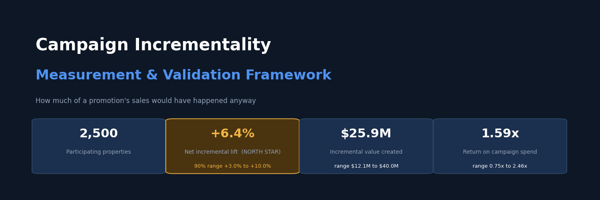
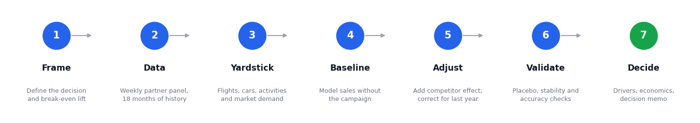
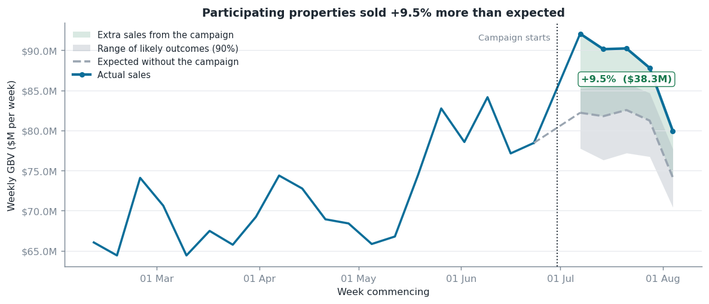
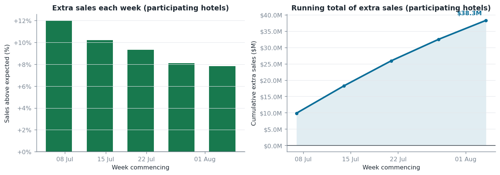
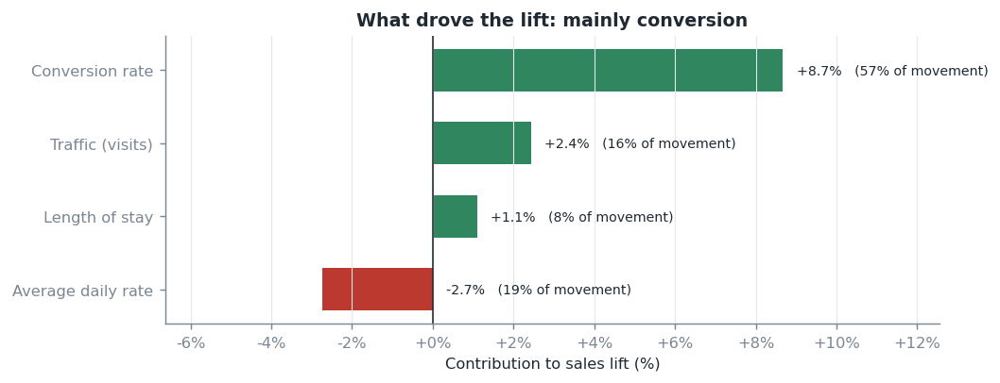
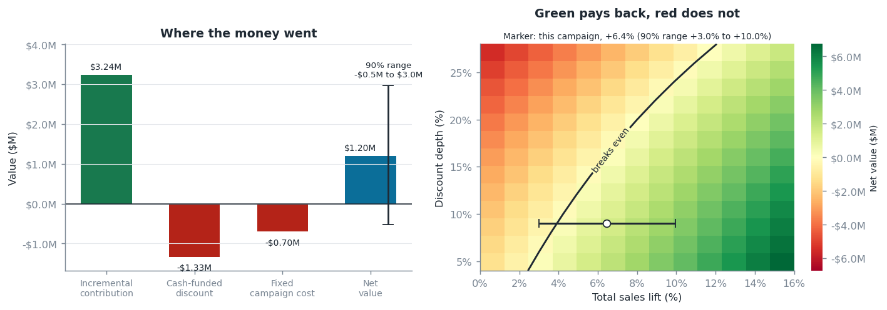
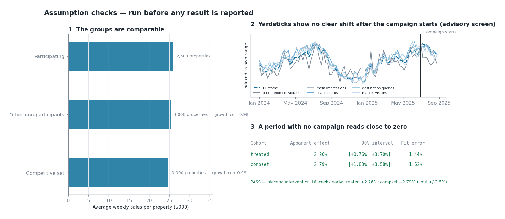
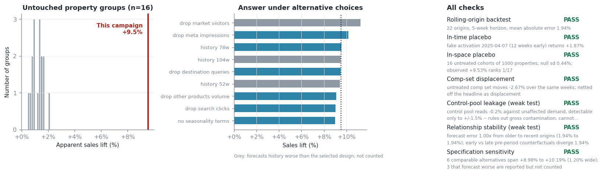

# Campaign Incrementality Measurement

**Aakanksha Baid** — Analytics Strategy Leader · [LinkedIn](https://www.linkedin.com/in/aakankshabaid/) · [GitHub](https://github.com/AakankshaBaid)



> Built on **simulated data** with a known correct answer, so the method's accuracy can be tested rather than assumed. No confidential data appears anywhere in this repo.

---

## Executive Summary

**The question:** when we discount, how much of the extra business did we actually create, and did it pay for itself?

A mid-year promotion ran across 2,500 partner properties. Participating hotels sold **9.5% more** than expected. But they took 2.7% from competing hotels next door, which are also ours. Netting that off:

| | |
| --- | ---: |
| Extra sales at participating hotels | **+$38.3M** |
| Sales taken from our other hotels | **-$12.4M** |
| **What the platform actually gained** | **+$25.9M** (+6.4%) |
| What it needed to cover its cost | $16.3M (4.05%) |
| **Return on spend** | **1.59x** (+$1.20M profit) |

**The estimate says it paid back, but the measurement alone cannot prove it.** Total lift of +6.4% is above the 4.05% needed, but the calibrated 90% range, +3.0% to +10.0%, includes break-even. Because the data is simulated, the true answer is known (+6.5%, $25.8M, 1.59x): it did pay back, and the range holds it.

The most likely outcome is that the campaign made money, about $1.2M on $2.0M spent. But the measurement is not precise enough to rule out that it only broke even or lost a little. In dollars, the range runs from a $0.5M loss to a $3.0M gain (0.75x to 2.46x). Repeating it is a reasonable bet, not a proven one.

Measuring only the participating hotels would have **overstated the return by about 48%** (2.36x instead of 1.59x).

Three findings matter more than the headline:

- **32% of what participating hotels gained came from our own other hotels.** That is business moved, not created.
- **83% of the discount went to bookings that would have happened anyway** ($12.2M of $14.8M granted).
- **The lift is mostly conversion.** Conversion rose +8.7%; traffic rose only +2.4%; price gave back 2.7%.

**Recommendation: run it again, but change who qualifies.** Narrowing eligibility and choosing participants who compete less with each other could lift the return from 1.59x to about 2.2x, if demand holds (see *Where the upside is*). Hold back a random 5% of competitive sets next time to measure it exactly. Treat a readout as unresolved when its range includes break-even. With ranges about ±3 points wide, that is any campaign clearing it by less than about 3 points, and all three simulated campaigns fall in that band: Black Friday was estimated at 1.06x and was truly 0.77x.

---

## Business Problem

- Promotional campaigns commit significant discount and media spend every year, but reported lift includes demand that would have arrived anyway
- Campaigns run during seasonal peaks, so simple before-and-after comparison measures the calendar, not the campaign
- No clean A/B test exists: partners sign up contractually, and a price cut is visible to everyone
- **Campaigns run in every market at once**, so there is no untreated market to compare against
- A sale won from a competing property down the road on our same platform looks identical to new demand in every standard report

**The decision this supports:** how deep should the next promotion discount, who should be eligible, and should it run at all?

---

## North Star Metric

**Total incremental booking value versus the lift needed to break even.**

*Total* means participating hotels **plus** the effect on their competitors. *Incremental* means against a modelled baseline of what would have happened anyway. *Versus break-even* means a lift only counts as good news if it covers what it cost to produce. Lifts are measured against participating hotels' baseline sales.

**Current result: +6.4% against a 4.05% break-even.** Above the line, though the 90% range (+3.0% to +10.0%) includes it.

---

## Skills

- Causal inference · incrementality measurement · counterfactual modelling
- Structural time series (state-space) models · conformal interval calibration · synthetic control · difference-in-differences
- Experiment design · power analysis · cluster-randomised holdout sizing
- Placebo testing · assumption testing · sensitivity analysis · model validation
- Monte Carlo simulation · ground-truth benchmarking · bias, RMSE and coverage
- KPI decomposition · driver attribution · marketing effectiveness
- Unit economics · break-even analysis · promotional pricing
- Python · SQL · pandas · statsmodels · pytest
- Executive communication · automated decision reporting

---

## Methodology



**We run two causal models and add them together.**

1. **Participating hotels:** how much more did they sell than they would have?
2. **Their direct competitors:** what happened to the hotels next door?

The second number carries its own sign. If competitors *lost* sales, the campaign moved business rather than creating it, and it comes off. If competitors *gained*, the campaign lifted the whole neighbourhood, and it adds. 

**Choosing the comparison group** The promotion runs everywhere at once, so every untouched hotel still sits next to a discounted competitor. The yardstick is therefore **non-hotel bookings (flights, cars, activities)**. They run in the same markets, move with the same travel demand week to week, and a hotel deal cannot discount them. Supporting signals are marketplace-wide demand: search clicks, metasearch, destination searches, site traffic.

Three more choices changed the answer materially:

- **Last year's campaign.** With high repeat participation the pre-period contains a treatment episode which sits inside the historical data and otherwise makes this year's result look smaller than it was. Ignoring it understates this year's result by about 3 points (measured below).
- **The discount is not double-counted.** Sales are measured at the prices customers paid, so the price cut is already in the number. Only the cash-funded share of the discount, servicing and fixed costs are charged. Break-even is the lift needed to cover the cost actually incurred.
- **The ranges are calibrated, not taken from the model.** Tested against known answers, the model's own 90% ranges were too narrow, so every reported range is widened by a factor of 2.00 fitted on 92 simulated campaigns (see Model Validation).

---

## Results

| | Participating hotels | Competitors | **Total** |
| --- | ---: | ---: | ---: |
| Estimated lift | +9.5% | -2.7% | **+6.4%** |
| Known true lift | +10.1% | -3.1% | +6.5% |
| Value | +$38.3M | -$12.4M | **+$25.9M** |

Room nights rose **+12.5%** against participants' value of +9.5%. The gap is the price cut reaching travellers, which confirms the deal landed. The calibrated 90% range on the total is +3.0% to +10.0%.

**Economics:** $3.24M of contribution against $2.03M of cost gives **+$1.20M and a 1.59x return**. Break-even needed 4.05%; the estimate is +6.4%, but its range (+3.0% to +10.0%) includes break-even.

**Baseline vs. actual** *(Exhibit C)*



**How the lift built and faded** *(Exhibit D)*



**What drove the lift** *(Exhibit E)*



| Driver | Contribution |
| --- | ---: |
| **Conversion rate** | **+8.7%** |
| Traffic | +2.4% |
| Length of stay | +1.1% |
| Average price | -2.7% |

The deal mostly persuaded people who were already browsing. It did not bring many new people in, so the lever is **eligibility**, not media spend.

**Member-only stacked discounts** add a further **+2.3%** (90% range +1.6% to +3.1%) among properties that offer them. The true effect is +2.3%, and the parallel-trends check holds (p=0.12).

**Economics and break-even** *(Exhibit G)*



The whisker on the net-value bar is the calibrated 90% range, a $0.5M loss to a $3.0M gain (0.75x to 2.46x). The marker on the map places this campaign's estimate and range against the break-even line, and the range crosses it.

### Where the upside is

The estimate says the campaign paid back, but not by much. Two levers raise the return, shown on the same participating-hotel gain:

| Scenario | Total lift | Return on spend |
| --- | ---: | ---: |
| As run | +6.4% | 1.59x |
| 25% less cannibalisation | +7.2% | 1.78x |
| 50% less cannibalisation | +8.0% | 1.97x |
| Deal on 25% of bookings (from 34%) | +6.4% | 1.93x |
| Deal on 18% of bookings | +6.4% | 2.30x |
| **Both, moderate: 25% less cannibalisation, deal on 25% of bookings** | +7.2% | **2.16x** |
| Both, aggressive: 50% less cannibalisation, deal on 18% of bookings | +8.0% | 2.85x |

Narrowing eligibility holds demand fixed, which is optimistic at the edges: tighten far enough and the lift will shrink. Treat it as a decision boundary, not a forecast.

---

## Model Validation

### 1. Accuracy against known answers

Because the data is simulated, every estimate can be scored against the truth. 12 simulated campaigns per design, identical data:

| Approach | Bias | Typical error | Raw range holds the truth |
| --- | ---: | ---: | ---: |
| **Flights, cars, activities + demand signals (selected)** | **+0.1 pts** | **1.2 pts** | **92%** |
| Same, ignoring last year's campaign | -3.1 pts | 3.4 pts | 50% |
| Last year's marketplace sales (excl. participants) + demand | +0.9 pts | 1.7 pts | 92% |
| Last year's market-wide sales + demand | +1.0 pts | 1.8 pts | 83% |

The selected approach detects **100%** of the real campaigns. Two cautions. Its first 12 campaigns were kinder to it than average: over 36 (adding 24 fresh ones) its bias is +0.6 points and its typical error 1.8, and the alternatives were only run on the first 12. And the model's own ranges were **too narrow**: they held the truth 81% of the time with a real effect and 75% with none, against a nominal 90%, and 18% of campaigns where nothing happened were wrongly declared wins. The next section fixes that. These studies run at 1,200 properties; the headline run uses 2,500.

**Fit statistics alone would pick the wrong design.** Ranked by how well each approach forecasts history, the selected one comes **5th of 8**. The better-fitting approaches rely on comparison series that a global campaign contaminates, or that do not exist when every market takes part, and one of them (competitors as the comparison) overstates the lift by 2.7 points (12.7% against a true 10.1%). Choosing the comparison on business logic, then testing it against known answers, is the point of the exercise.

### 2. Calibrating the ranges

The model's ranges come from a backtest on history that never contains the campaign window, and tested against known answers they were too narrow. I fitted one widening factor, 2.00, so that the reported 90% range holds the truth about 90% of the time, using a split-conformal rule (`src/incrementality/calibration.py`, `studies/interval_calibration_study.py`). Out of sample (10-fold cross-validation over 92 simulated campaigns):

| Campaigns | n | Raw range holds the truth | Calibrated range holds the truth | Wrongly declared wins |
| --- | ---: | ---: | ---: | ---: |
| With a real effect | 36 | 81% | **89%** (74% to 97%) | not applicable; still detected 100% |
| With no effect | 56 | 75% | **95%** (85% to 99%) | 18% before, **4%** after |

Two things to know:

- **A first attempt fell short, which is why the factor is 2.00 and not 1.35.** Fitted on the original 38 campaigns, a pooled factor of 1.35 fixed the no-effect case on 54 fresh campaigns (range holds the truth 77% to 90%, wrongly declared wins 20% to 7%) but left campaigns with a real effect at 75%. Real-effect errors are larger and biased upward (bias +0.6 points, typical error 1.8, against +0.4 and 1.7 with no effect), so the factor is now set by the harder case.
- **The price is resolution.** Ranges are twice as wide, and none of the three campaigns below can be called either way. The factor is calibrated for this simulator; on live data, recompute it from historical campaigns or placebo windows.

### 3. Assumption checks on this campaign *(Exhibit H)*



| Check | Question | Result |
| --- | --- | --- |
| Groups are comparable | Do the participating and competing hotels move together historically? | **Pass** — 0.99 correlation |
| Yardsticks are clean | Were the comparison series themselves moved by the campaign? | **Pass** — advisory screen (see Notes) |
| Quiet-period test | Does a period with no campaign read close to zero? | **Pass, narrowly** — treated +2.26%; compset +2.79% (limit ±3.5%) |

### 4. Validation tests on this campaign *(Exhibit F)*



| Test | Question | Result |
| --- | --- | --- |
| Forecast accuracy | Can the model predict this business at all? | **Pass** — 1.9% average error |
| Fake campaign in time | Would it find a lift in a period where none ran? | **Pass, narrowly** — +1.9% (limit ±2%) |
| Fake campaign in space | Does any random group of hotels look like this? | **Pass** — real result ranks 1st of 17 |
| Competitor displacement | Did sales just move between our hotels? | **Pass** — -2.7% found and netted off |
| Yardstick leakage | Was the comparison group affected? | **Pass** — no gross contamination; weak test, see Notes |
| Relationship stability | Has the relationship drifted over time? | **Pass** — 1.9% gap (limit 4.5%); weak test, see Notes |
| Window cherry-picking | Do equally good alternatives agree? | **Pass** — 1.2 point spread (limit 2.5) |

Both placebo tests read positive and sit close to their limits, consistent with the method's typical error of about 1.7 to 1.8 points. A comfortable pass on both would be stronger evidence.

### 5. Three campaigns against the truth

| Campaign | Estimated total lift | True lift | Break-even | Return (est.) | Return (true) | Method's verdict | Truth | Checks passed |
| --- | --- | ---: | ---: | ---: | ---: | --- | --- | ---: |
| Mid-year sale | +6.4% (+3.0% to +10.0%) | +6.5% | 4.0% | 1.59x | 1.59x | Cannot tell | Pays back | 3/3 + 7/7 |
| Spring sale | +5.9% (+2.8% to +8.8%) | +6.4% | 2.9% | 2.06x | 2.22x | Cannot tell | Pays back | 3/3 + 6/7 |
| Black Friday | +8.1% (+5.2% to +11.9%) | +5.9% | 7.7% | 1.06x | 0.77x | Cannot tell | Loses money | 3/3 + 6/7 |

**With honest ranges, the method calls none of the three, and none of its calls is wrong.** Each campaign clears break-even by less than the width of its range, so all three read "cannot tell", and the truth sits inside every range, Black Friday's included. **The check count still did not predict accuracy:** Black Friday passes 3/3 assumption checks and 6/7 validation tests, yet its estimate is +2.3 points off (1.06x against a true 0.77x). I tested one explanation, that last year's campaign overlaps the holiday weeks, and it did not hold: across 6 simulated Black Friday campaigns the error was +0.8 points with 78 weeks of history and +1.1 with 104, so a longer history did not help (`studies/history_length_study.py`). **The cause is not identified.** Any campaign landing within about 3 points of break-even needs a holdout, not a model.

---

## Known Limitations and Status

| Issue | Evidence | Status | What it would take |
| --- | --- | --- | --- |
| The model's ranges were too narrow and the win rule fired too often | Raw 90% ranges held the truth 75% to 81% of the time; 18% of no-effect campaigns were wrongly declared wins | **Fixed.** A widening factor of 2.00, tested out of sample: ranges hold the truth 89% to 95% of the time and 4% of no-effect campaigns are wrongly declared wins | Recompute the factor on live history. The cost is resolution: ranges are twice as wide |
| Spring and Black Friday fail the specification-sensitivity test | Equally good alternatives span 3.5 and 3.6 points against a 2.5 limit; the swing is largest when site traffic (`market_visitors`) is dropped | **Open, by design.** The test is doing its job: it flags campaigns whose answer depends on modelling choices, and it fires on about 1 in 10 healthy campaigns | Controls whose choice does not matter, or averaging over specifications. Neither is built |
| Black Friday's estimate is 2.3 points off | 1.06x estimated, 0.77x true | **Open.** Cause unidentified, and a longer history did not help. The calibrated range (+5.2% to +11.9%) now holds the truth, and the verdict is "cannot tell" | A systematic study of the peak-season window |
| The stability test is weak | Flagged 7 of 14 campaigns with severe injected drift and 1 of 14 stable ones | **Open.** A pass is weak evidence | A better statistic and a larger study |
| The yardstick screen and the leakage test are weak | The screen flagged 3 of 7 healthy campaigns; the leakage test only rules out gross contamination | **Open.** Both are advisory | Validation on live data |
| Untested | Python 3.10, the GitHub CI workflow, the SQL on a real warehouse, and any real data | **Open** | Running them |

---

## Business Impact

*Simulated figures.*

- **Estimated the mid-year promotion at +6.4% total lift ($25.9M, 1.59x),** within 0.1 points of the known truth, and showed that its calibrated 90% range (+3.0% to +10.0%) still includes break-even.
- **Exposed a 48% overstatement** in participant-only reporting (2.36x against 1.59x). $12.4M of the apparent gain was business moved between our own hotels.
- **Sized $12.2M of discount (83%)** given to bookings that would have happened anyway.
- **Found and fixed ranges that were too narrow:** the model's own ranges held the truth 75% to 81% of the time and 18% of no-effect campaigns were wrongly declared wins. After calibrating on 92 simulated campaigns, out of sample, ranges hold the truth 89% to 95% of the time and 4% are wrongly declared wins.
- **Sized a randomised holdout:** holding back 10 competitive sets (about 120 hotels, 5%) would detect lifts of 1.6% or more.

---

## Business Recommendations

1. **Run this campaign type again, but narrow eligibility.** 83% of the discount went to bookings that would have happened anyway. Combined with choosing less-overlapping participants, the return could rise from 1.59x to about 2.2x if demand holds.
2. **Report total incrementality, never the participant lift alone.** It overstated the return by 48%.
3. **Pick participants who compete less with each other.** 32% of participants' gain was moved from our own hotels.
4. **Hold back a random 5% of competitive sets next campaign.** Whole competitive sets, not single hotels: a held-back hotel still sits beside discounted rivals. It measures the total effect directly and detects lifts of 1.6% or more, against 2.5% for the model with calibrated ranges.
5. **Treat any readout whose range includes break-even as unresolved.** The calibrated ranges are about ±3 points wide, so within about 3 points of break-even only a holdout can settle it. All three simulated campaigns, Black Friday included, fall in that band.
6. **Require a win to be positive, material (at least 1%) and statistically significant.** A measurable 0.1% lift is not a business result. With calibrated ranges this rule wrongly passes 4% of no-effect simulations (out of sample), so one readout is strong evidence of an effect, but not proof of a payback.
7. **Check break-even before launch.** This campaign needed 4.0%, knowable from its cost structure in advance.

---

## Scoping for a Phased Rollout

| Phase | Duration | Scope | Done when |
| --- | --- | --- | --- |
| **1. Foundation** | 4–6 weeks | Build the weekly data view; confirm non-hotel booking and demand feeds; backfill 18 months | Reconciles to finance within 0.5% |
| **2. Retrospective** | 4 weeks | Re-measure 4–6 past campaigns, including one peak-season campaign | Every result explained; peak-season uncertainty documented |
| **3. Parallel run** | One cycle | New readout alongside existing reporting | Stakeholders can explain the differences |
| **4. Production** | 6 weeks | Scheduled reporting, automated memos, pre-launch break-even screening | Readout within 5 working days of close |
| **5. Holdout pilot** | One campaign | Randomise 5% of competitive sets; compare against the model | Model and holdout agree within the model's error |

Prove it on an off-peak campaign first, then use the holdout pilot to calibrate the model before trusting it on peak season. **Dependencies:** booking, traffic, non-hotel production and competitive-set data; agreement to hold back a sample before launch; about 0.5 FTE analyst through phases 2–4.

---

## Next Steps

- Pilot the randomised holdout; it is worth more than any modelling change
- Find out why Black Friday is less accurate (about +0.8 points over 6 simulated campaigns; cause unidentified)
- Confirm on live data that search clicks and site traffic are not moved by the campaign's own marketing
- Replace the placeholder cluster size and correlation in the holdout sizing with real competitive-set data
- Narrow the ranges honestly: they are twice the model's own width because real-effect errors are larger and biased upward (about +0.6 points). Finding the source of that bias would shrink them more than any recalibration
- Measure repeat bookings after the campaign window, add regional and segment breakdowns, and estimate discount elasticity

---

## FAQ

- **Why simulated data?** The true answer is known, so the method can be tested against it. That is impossible on live data, where the right answer is exactly what you are trying to find.
- **Why not an A/B test?** Partners sign up contractually and a price cut is public, so no clean group exists to hold back. That is why the next-campaign holdout is a recommendation.
- **The campaign runs everywhere. What do you compare against?** Not untouched hotels; none exist. Flights, cars and activities share the same travel demand but cannot be discounted by a hotel deal.
- **Why add the competitor effect rather than subtract it?** Its sign is the finding. Negative means we cannibalised ourselves; positive means we lifted the neighbourhood.
- **How do I know the number is right?** Three ways: accuracy against known answers, the checks on the campaign itself, and, ideally, a holdout. The checks alone are not enough, as Black Friday shows.
- **Can this run on live data?** Yes: one data-loading step is replaced with the production query in `sql/`. Recompute the range-widening factor on your own historical campaigns first (`studies/interval_calibration_study.py`).

---

## Notes

Fully synthetic. No proprietary data appears here.

- **Everything regenerates.** The three campaigns' tables, memos and figures, and the known truth, regenerate identically from the committed code and fixed seeds.
- **The simulation's demand series cannot be moved by the campaign, by construction.** On live data, campaign marketing may lift search clicks and site traffic. The screen for this ("Yardsticks are clean") is advisory: on healthy simulated campaigns it still flagged 3 of 7, so a flag means "look at the series", not "reject the result".
- **Other non-participants are placebo units only.** They show what "no campaign" looks like in the random-group test and are never used as a comparison. Any spillover onto them would make that test slightly conservative.
- **The yardstick-leakage test is weak, and mostly moot here.** It can only rule out contamination of the comparison group above about ±1.5%, and the selected design does not use that group as a comparison at all.
- **The stability test is weak.** In simulation it flagged 1 of 14 stable campaigns but only 7 of 14 with severe injected drift (60%), and 1 of 5 at 35% (`outputs/tables/assumption_drift_scores.csv`). A pass is weak evidence that the relationship held.
- **Thresholds are calibrated on simulation.** The quiet-period limit (3.5%) and the stability limit (4.5%) come from stable simulated data, so they catch only fabricated effects above those sizes. Recalibrate on your own history.
- **The range-widening factor is calibrated for this simulator,** and the harder case, a real effect, sets it. It makes ranges conservative when nothing is happening (95% coverage). Driver and stacking ranges use the same factor but were not validated separately.
- **Accuracy studies run at 1,200 properties:** 12 campaigns per design in the design comparison, and 36 with an effect and 56 without in the calibration pool. Treat the figures as indicative.
- **The stacking estimate references the weeks just before activation,** not last year's same weeks, because those contain last year's campaign and make the two groups look non-parallel. On the three campaigns here it lands within 0.1 points of the known effect (`outputs/tables/ground_truth.json`), and a regression test scores it against the truth on five further simulated campaigns.
- **Tests.** 63 tests. A full run of the 60 earlier tests passed on both the latest releases (pandas 3.0, numpy 2.4, scipy 1.17, statsmodels 0.15) and the oldest installable under the declared floors (pandas 2.1, numpy 1.26, scipy 1.11, statsmodels 0.14.1) before the last exhibit and memo changes. Since then, 12 source files were reformatted (formatting only; their syntax trees are identical to before), and the 10 tests that reach the changed code, including the 3 new ones, pass on both stacks. Python 3.10 and the GitHub CI workflow itself are untested.
- **The SQL is executed in the test suite** against synthetic tables (DuckDB, transpiled from Trino), including a hotel that drops out of the campaign: dropouts, and hotels whose only rival dropped out, are excluded from every cohort. It has **not** been run against a real warehouse or real table schemas.
- **Holdout sizing assumes** 12 hotels per competitive set and a within-set correlation of 0.15, because the simulated panel carries no competitive-set identifier.
- **Limitations.** Results exclude repeat bookings after the campaign. Partners opted in, so findings apply to those who took part. The eligibility scenarios assume demand holds.

---

## Exhibits

| Exhibit | Description |
| --- | --- |
| **A** | Executive overview: headline figures with their ranges |
| **B** | Methodology at a glance |
| **C** | What happened vs. what would have happened |
| **D** | How the lift built and faded |
| **E** | What drove the lift |
| **F** | Validation dashboard (weak tests labelled) |
| **G** | Economics and break-even, with the calibrated range |
| **H** | Assumption checks |

Each run also writes a [one-page decision memo](outputs/mid_year_sale_2025_decision_memo.md) generated from the results, so no figure is ever re-typed.

---

## Repo Structure

```
.
├── configs/            One file per campaign: no code changes needed
├── src/incrementality/ Measurement engine, assumption checks, validation,
│                       driver decomposition, economics, holdout sizing, reporting
├── studies/            Accuracy, interval-calibration, history-length and assumption-sensitivity studies
├── sql/                Production query and data quality gates
├── tests/              63 automated tests
└── outputs/            Exhibits, tables, ground truth and decision memos
```

## Running It

```bash
pip install -e ".[dev]"

make run         # measure the reference campaign, produce all exhibits
make all         # every campaign in configs/
make diagnose    # model adequacy, power, design ranking, holdout sizing
make test        # 63 automated tests (4 SQL tests need duckdb, installed by the dev extra)
```

Measuring a new campaign takes a short config file, not new code. Every figure is reproducible from a fixed seed, and all exhibits are committed, so the results read on GitHub without running anything.
